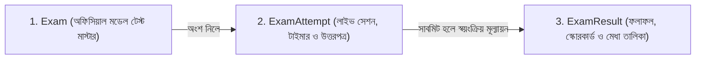
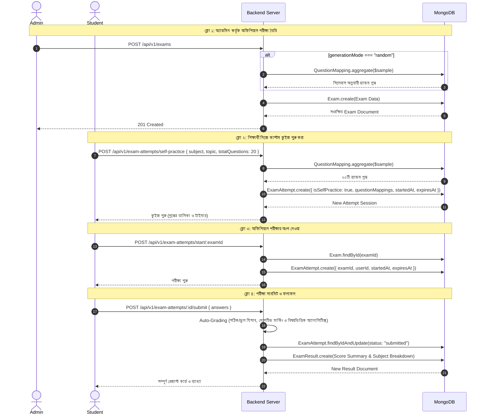

# 🏆 Final Exam Engine Architecture & Atomic Data Models

এই ডকুমেন্টে গৃহীত সকল সিদ্ধান্তের আলোকে **Exam Engine**-এর ৩টি সম্পূর্ণ স্বতন্ত্র, অ্যাটমিক (Atomic) ও ইন্ডাস্ট্রি-স্ট্যান্ডার্ড মডেলের পূর্ণাঙ্গ স্পেসিফিকেশন দেওয়া হলো।

---

## 🧭 মূল আর্কিটেকচারাল রূপরেখা (Atomic Architecture)

সিস্টেমটিকে **Single Responsibility Principle (SRP)** অনুযায়ী ৩টি পরিষ্কার স্তরে বিভক্ত করা হয়েছে:



1. **`Exam`**: অ্যাডমিন কর্তৃক তৈরি কৃত অফিশিয়াল পরীক্ষা বা মডেল টেস্ট (কোনো স্টুডেন্ট ডাটা থাকবে না)।
2. **`ExamAttempt`**: পরীক্ষা চলাকালীন লাইভ সেশন, টাইমার এবং শিক্ষার্থীর দেওয়া উত্তর (খাতা দেখার আগের লাইভ স্টেট)।
3. **`ExamResult`**: পরীক্ষা সাবমিট হওয়ার পর স্বয়ংক্রিয় মূল্যায়নের মাধ্যমে তৈরি হওয়া স্কোরকার্ড ও বিষয়ভিত্তিক অ্যানালিটিক্স।

---

## 📦 ১. মডেল: `Exam` (অফিশিয়াল মডেল টেস্ট)

অ্যাডমিন এই মডেলের মাধ্যমে যেকোনো অফিশিয়াল পরীক্ষা তৈরি করবে (ম্যানুয়ালি প্রশ্ন বাছাই করে অথবা র‍্যান্ডম মোডে অটো-স্যাম্পল করে)।

### 📋 Mongoose Interface (`exam.interfaces.ts`)

```typescript
import { Schema, model, Types, Document } from "mongoose";

export type TExamLevel = "category" | "track" | "subject" | "topic";
export type TExamGenerationMode = "manual" | "random";
export type TExamType = "live" | "practice" | "archive";
export type TExamStatus = "draft" | "published" | "archived";

export interface IExam {
  title: string;
  slug: string;
  description?: string | null;

  // ১. পরীক্ষার লেভেল
  examLevel: TExamLevel; // "category" | "track" | "subject" | "topic"

  // ২. সিলেবাস হায়ারার্কি রেফারেন্স (লেভেল অনুযায়ী পূরণ থাকবে)
  category: Types.ObjectId;             // কোর্সের ক্যাটাগরি (Required, যেমন: বিসিএস প্রিলি)
  track?: Types.ObjectId | null;        // যদি track-based হয় (যেমন: টেকনিক্যাল ক্যাডার)
  subject?: Types.ObjectId | null;      // যদি subject-based বা topic-based হয় (যেমন: বাংলা)
  topic?: Types.ObjectId | null;        // যদি topic-based হয় (যেমন: চর্যাপদ)

  // ৩. প্রশ্ন তৈরির মোড
  generationMode: TExamGenerationMode;  // "manual" (অ্যাডমিনের পছন্দমতো) | "random" (অটো স্যাম্পল)

  // ৪. পরীক্ষার সময় ও মার্কিং নিয়ম (সরাসরি Exam মডেলে নির্ধারিত)
  durationMins: number;                 // পরীক্ষার মোট সময় (মিনিট)
  totalQuestions: number;               // মোট প্রশ্ন সংখ্যা (যেমন: ২০০ বা ৫০)
  marksPerQuestion: number;             // প্রতি প্রশ্নের মান (যেমন: ১.০০ বা ০.৫০)
  negativeMarks: number;                // ভুল উত্তরের জন্য কাটা যাবে (যেমন: ০.২৫ বা ০)
  totalMarks: number;                   // মোট পূর্ণমান (totalQuestions * marksPerQuestion)
  passMarks: number;                    // পাস করার জন্য ন্যূনতম নম্বর

  // ৫. প্রশ্নের তালিকা (Mapping ID-র সাধারণ ফ্ল্যাট অ্যারে)
  questionMappings: Types.ObjectId[];   // [ mappingId1, mappingId2, ... ]

  // ৬. কনফিগারেশন
  isRandomized: boolean;                // শিক্ষার্থীর জন্য প্রশ্নের সিরিয়াল শাফল হবে কি না (Default: true)
  isOptionShuffled: boolean;            // অপশনগুলো শাফল হবে কি না (Default: true)

  // ৭. শিডিউলিং ও স্ট্যাটাস
  examType: TExamType;                  // 'live' (নির্দিষ্ট সময়ে) | 'practice' (যেকোনো সময়)
  startTime?: Date | null;              // লাইভ পরীক্ষা শুরুর সময়
  endTime?: Date | null;                // লাইভ পরীক্ষা শেষ হওয়ার সময়

  status: TExamStatus;                  // 'draft' | 'published' | 'archived'
  author: Types.ObjectId;               // যে অ্যাডমিন তৈরি করেছে
}

export interface IExamDoc extends Document, IExam {}
```

---

## ⏱️ ২. মডেল: `ExamAttempt` (লাইভ সেশন ও উত্তরপত্র)

শিক্ষার্থী যখন কোনো অফিশিয়াল মডেল টেস্টে অংশ নেয় কিংবা নিজে কোনো বিষয়ের **Self-Practice Quiz** শুরু করে, তখন এই মডেল তৈরি হয়।

### 📋 Mongoose Interface (`exam-attempt.interfaces.ts`)

```typescript
import { Schema, model, Types, Document } from "mongoose";

export type TExamAttemptStatus = 
  | "in_progress"   // পরীক্ষা চলছে
  | "submitted"     // শিক্ষার্থী নিজে সাবমিট করেছে
  | "time_out"      // টাইমার শেষ হওয়ায় সার্ভার অটো-সাবমিট করেছে
  | "cancelled";    // বাতিল

export interface IUserAnswer {
  mappingId: Types.ObjectId;            // কোন প্রশ্নের উত্তর
  userAnswer?: string | string[] | null;// শিক্ষার্থীর নির্বাচিত অপশন আইডি বা টেক্সট
  isMarkedForReview: boolean;           // পরে দেখার জন্য ফ্ল্যাগ করেছে কি না
  timeSpentSeconds: number;             // এই নির্দিষ্ট প্রশ্নে কত সেকেন্ড সময় নিয়েছে
}

export interface IExamAttempt {
  // ১. পরীক্ষার ধরন ও রেফারেন্স
  isSelfPractice: boolean;              // true হলে স্টুডেন্টের কাস্টম কুইজ, false হলে অ্যাডমিনের অফিশিয়াল এক্সাম
  examId?: Types.ObjectId | null;       // অফিশিয়াল এক্সাম হলে Exam ID (Self-practice হলে null)
  userId: Types.ObjectId;               // যে শিক্ষার্থী পরীক্ষা দিচ্ছে
  attemptNumber: number;                // কততম বার এই পরীক্ষায় অংশ নিচ্ছে

  // সেলফ প্র্যাকটিসের ক্ষেত্রে সিলেবাস রেফারেন্স (যদি কাস্টম কুইজ হয়)
  selfPracticeConfig?: {
    subject?: Types.ObjectId | null;
    topic?: Types.ObjectId | null;
  } | null;

  // ২. সেশন ও টাইমার কন্ট্রোল
  status: TExamAttemptStatus;
  startedAt: Date;                      // পরীক্ষা শুরুর সঠিক সময়
  expiresAt: Date;                      // শেষ হওয়ার সর্বোচ্চ সার্ভার ডেডলাইন (startedAt + duration)
  submittedAt?: Date | null;            // শিক্ষার্থী কখন সাবমিট করেছে
  totalTimeTakenSeconds: number;        // মোট কত সেকেন্ড সময় নিয়েছে

  // ৩. এই সেশনের প্রশ্ন ও উত্তরপত্র
  questionMappings: Types.ObjectId[];   // এই শিক্ষার্থীর জন্য নির্ধারিত প্রশ্নের আইডি (শাফল ক্রমে)
  answers: IUserAnswer[];               // শিক্ষার্থীর দেওয়া উত্তরের তালিকা

  // ৪. অ্যান্টি-চিটিং ও সিকিউরিটি
  tabSwitchCount: number;               // পরীক্ষা চলাকালীন কতবার ট্যাব সুইচ করেছে
  ipAddress?: string | null;
  userAgent?: string | null;
}

export interface IExamAttemptDoc extends Document, IExamAttempt {}
```

---

## 📊 ৩. মডেল: `ExamResult` (ফলাফল, স্কোরকার্ড ও মেধা তালিকা)

পরীক্ষা সাবমিট হওয়ার পর খাতা মূল্যায়নের মাধ্যমে এই মডেল তৈরি হয়। এটি সম্পূর্ণ লাইটওয়েট, ফলে লিডারবোর্ড ও অ্যানালিটিক্স মুহূর্তেই লোড হয়।

### 📋 Mongoose Interface (`exam-result.interfaces.ts`)

```typescript
import { Schema, model, Types, Document } from "mongoose";

export interface ISubjectScore {
  subjectId: Types.ObjectId;            // কোন বিষয়ের হিসাব
  subjectName?: string;
  total: number;                        // এই বিষয়ে মোট প্রশ্ন
  answered: number;                     // কয়টির উত্তর দিয়েছে
  correct: number;                      // সঠিক উত্তর
  wrong: number;                        // ভুল উত্তর
  score: number;                        // এই বিষয়ে অর্জিত মোট নম্বর
}

export interface IExamResult {
  attemptId: Types.ObjectId;            // কোন Attempt থেকে রেজাল্ট তৈরি হলো (1-to-1 relationship, unique)
  examId?: Types.ObjectId | null;       // কোন পরীক্ষা (Self-practice হলে null)
  userId: Types.ObjectId;               // শিক্ষার্থী
  isSelfPractice: boolean;              // কাস্টম কুইজ কি না

  // ১. স্কোরকার্ড (Marks Summary)
  totalQuestions: number;               // মোট প্রশ্ন
  totalAnswered: number;                // মোট উত্তর দেওয়া হয়েছে
  totalSkipped: number;                 // ছেড়ে দেওয়া প্রশ্ন
  correctCount: number;                 // সঠিক উত্তরের সংখ্যা
  wrongCount: number;                   // ভুল উত্তরের সংখ্যা

  obtainedMarks: number;                // সঠিক উত্তরের জন্য মোট অর্জিত নম্বর
  deductedMarks: number;                // নেগেটিভ মার্কিংয়ের জন্য কাটা যাওয়া নম্বর
  finalScore: number;                   // চূড়ান্ত স্কোর (obtainedMarks - deductedMarks)
  percentage: number;                   // প্রাপ্ত নম্বরের শতকরা হার
  isPassed: boolean;                    // পাস করেছে কি না
  rank?: number | null;                 // মেধা তালিকায় অবস্থান (লাইভ পরীক্ষার জন্য)

  // ২. বিষয়ভিত্তিক দুর্বলতা ও শক্তির বিশ্লেষণ
  subjectBreakdown: ISubjectScore[];

  createdAt: Date;
}

export interface IExamResultDoc extends Document, IExamResult {}
```

---

## 🔄 সম্পূর্ণ সিস্টেমের সিকোয়েন্স ডায়াগ্রাম (Workflow)



---

## 📁 প্রজেক্ট ফোল্ডার স্ট্রাকচার

এই ৩টি অ্যাটমিক মডেল তৈরির জন্য `src/app/modules/` এর অধীনে নিচের মডিউলগুলো থাকবে:

```text
src/app/modules/
├── Exam/                       # অফিশিয়াল মডেল টেস্ট ব্যবস্থাপনা
│   ├── exam.constants.ts
│   ├── exam.interfaces.ts
│   ├── exam.model.ts
│   ├── exam.validations.ts
│   ├── exam.services.ts
│   ├── exam.controllers.ts
│   └── exam.routes.ts
│
├── ExamAttempt/                # লাইভ সেশন, টাইমার ও সেলফ-প্র্যাকটিস কুইজ
│   ├── exam-attempt.constants.ts
│   ├── exam-attempt.interfaces.ts
│   ├── exam-attempt.model.ts
│   ├── exam-attempt.validations.ts
│   ├── exam-attempt.services.ts
│   ├── exam-attempt.controllers.ts
│   └── exam-attempt.routes.ts
│
└── ExamResult/                 # ফলাফল, লিডারবোর্ড ও অ্যানালিটিক্স
    ├── exam-result.interfaces.ts
    ├── exam-result.model.ts
    ├── exam-result.services.ts
    ├── exam-result.controllers.ts
    └── exam-result.routes.ts
```
