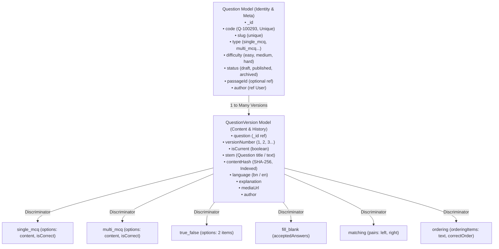

# 📚 Question & QuestionVersion Model — Simple Architecture & Implementation Guide

এই ডকুমেন্টে Prostuti-Hub-এর `Question` এবং `QuestionVersion` মডেলের আর্কিটেকচার, একই প্রশ্নের পুনরাবৃত্তি (duplicate stems), স্লাগ জেনারেশন, HTML হ্যান্ডলিং এবং প্রোডাকশন-গ্রেড বেস্ট প্র্যাকটিস সহজ ভাষায় ব্যাখ্যা করা হয়েছে।

---

## ১. Prostuti-Hub-এর বর্তমান মডেল আর্কিটেকচার (Model Overview)

প্রজেক্টে প্রশ্ন ম্যানেজমেন্টকে **Identity (পরিচয়)** এবং **Content (কনটেন্ট ও ভার্সন)** — এই দুই ভাগে ভাগ করা হয়েছে:



### সম্পর্কিত অন্যান্য মডেলসমূহ:
- **Passage**: রিডিং কম্প্রিহেনশন প্যাসেজ (প্যাসেজভিত্তিক একাধিক প্রশ্নের ক্ষেত্রে `passageId` দিয়ে যুক্ত থাকে)।
- **Topic**: সাবজেক্ট ও চ্যাপ্টারের হায়ারার্কি।
- **Subject**: বিষয় (যেমন: বাংলা, ইংরেজি, গণিত, সাধারণ জ্ঞান)।
- **Collection**: প্রশ্ন ব্যাংক, মডেল টেস্ট বা প্রশ্ন সংকলন।
- **User**: লেখক, মডারেটর এবং পরীক্ষার্থী।

---

## ২. প্রশ্নের উত্তর ও বিস্তারিত ব্যাখ্যা (Q&A)

---

### প্রশ্ন ১: "What is your name?" — একই প্রশ্ন ডাটাবেজে কয়বার থাকতে পারে?

**সহজ উত্তর:** **যতবার ইচ্ছা ততবার থাকতে পারে (সীমাহীন)।**

**ব্যাখ্যা:**
- বাস্তব জীবনের চাকরির পরীক্ষা (BCS, Bank, Primary), ভর্তি পরীক্ষা বা একাডেমিক পরীক্ষায় জেনেরিক প্রশ্ন শত শত বার আসে। যেমন:
  - *"What is the synonym of 'Abate'?"*
  - *"নিচের কোনটি সঠিক বানান?"*
  - *"Fill in the blank with appropriate preposition."*
  - *"Choose the correct sentence."*
- এগুলো ভিন্ন ভিন্ন বিষয়, ভিন্ন টপিক, ভিন্ন অপশন বা ভিন্ন সালের পরীক্ষায় আসতে পারে।
- তাই ডাটাবেজে **Question Stem কখনো Unique হবে না**।
- প্রতিটি প্রশ্ন ডাটাবেজে আলাদা সত্ত্বা হিসেবে সেভ হবে এবং তাদের পরিচয় হবে তাদের নিজস্ব `_id` এবং ইউনিক `code` (যেমন: `Q-102931`, `Q-591823`) দিয়ে।

---

### প্রশ্ন ২: একই Stem (যেমন: "Which meaning is correct?") কিন্তু Options ভিন্ন — এটা কি Allow করা যাবে?

**সহজ উত্তর:** **হ্যাঁ, ১০০% Allow করতে হবে।**

**বাস্তব উদাহরণ:**
- **প্রশ্ন A:**
  - Stem: `"Which spelling is correct?"`
  - Options: `A: Lieutenant`, `B: Leftenant`, `C: Lieutenent`, `D: Luetenant`
  - Exam: *35th BCS*
- **প্রশ্ন B:**
  - Stem: `"Which spelling is correct?"`
  - Options: `A: Accommodate`, `B: Acomodate`, `C: Accomodate`, `D: Acomdate`
  - Exam: *Primary Teacher Exam 2023*

দুটো প্রশ্নের Stem হুবহু এক, কিন্তু প্রশ্ন দুটি সম্পূর্ণ আলাদা। ডাটাবেজে তারা দুটি সম্পূর্ণ স্বাধীন `Question` ডকুমেন্ট হিসেবে থাকবে। তাদের `code`, `_id` এবং `contentHash` আলাদা থাকবে:
- **প্রশ্ন A-এর contentHash:** `sha256("single_mcq:::which spelling is correct?:::leftenant|lieutenant|lieutenent|luetenant")`
- **প্রশ্ন B-এর contentHash:** `sha256("single_mcq:::which spelling is correct?:::accommodate|accomodate|acomdate")`

হ্যাশ দুটি সম্পূর্ণ ভিন্ন হওয়ায় ব্যাকএন্ড এক মুহূর্তেই বুঝতে পারে তারা দুটি সম্পূর্ণ ভিন্ন প্রশ্ন।

---

### প্রশ্ন ৩: Production-Grade অ্যাপ্লিকেশনে কোন Approach ফলো করা হয়?

প্রোডাকশন-গ্রেড প্ল্যাটফর্মগুলোতে (যেমন: PrepLadder, 10 Minute School, LeetCode, Moodle) নিচের স্ট্যান্ডার্ড ফলো করা হয়:

1. **Separation of Metadata & Content (যা আপনি অলরেডি করেছেন):**
   - `Question`: মূল পরিচিতি (`code`, `slug`, `type`, `difficulty`, `status`, `passageId`)।
   - `QuestionVersion`: প্রশ্নের মূল কন্টেন্ট (`stem`, `options`, `explanation`, `isCurrent`)।
2. **Identification Rules:**
   - **Internal Primary Key**: MongoDB-র `_id`।
   - **Public Code**: মানুষের পড়ার মতো ইউনিক কোড (যেমন: `Q-104928` বা Nanoid)।
   - **Unique SEO Slug**: `[clean-stem-summary]-[code]` (যেমন: `which-spelling-is-correct-q-104928`)। স্লাগের শেষে ইউনিক কোড থাকায় স্লাগ সবসময় ১০০% ইউনিক থাকে।
3. **Soft Deduplication Warning (Never Hard Block):**
   - এডমিন প্যানেলে যখন কেউ প্রশ্ন ইনপুট দেয়, তখন ব্যাকএন্ড বা ফ্রন্টএন্ড সার্চ করে সতর্কবার্তা দেখাতে পারে:
     > *"এই স্টেমের সাথে মিল থাকা ২টি প্রশ্ন অলরেডি সিস্টেমে আছে। আপনি কি নতুন প্রশ্ন তৈরি করবেন নাকি আগেরটি ব্যবহার করবেন?"*
   - কিন্তু ডাটাবেজ লেভেলে কখনো হার্ড ব্লক (Unique Index on Stem) দেওয়া হয় না।

---

### প্রশ্ন ৪: Slug তৈরির সময় Stem-এ HTML ট্যাগ থাকলে কী করব?

**সমস্যা:**
যদি Stem হয়: `<p>What is the <strong>formula</strong> of water?</p>`
সরাসরি slugify করলে আউটপুট হবে: `p-what-is-the-strong-formula-strong-of-water-p` (যা দেখতে বাজে এবং এসইওর জন্য ক্ষতিকর)।

**সমাধান (৩টি সহজ ধাপ):**

1. **HTML ট্যাগ রিমুভ (Strip) করা**: স্লাগ জেনারেট করার আগে রেগুলার এক্সপ্রেশন বা হেল্পার দিয়ে সব HTML ট্যাগ ফেলে দিয়ে পিওর টেক্সট নেওয়া।
2. **টেক্সট ছোট (Truncate) করা**: পুরো প্রশ্ন না নিয়ে প্রথম ৫০–৬০ ক্যারেক্টার নেওয়া।
3. **ইউনিক কোড যুক্ত করা**: শেষে প্রশ্নের ইউনিক `code` যোগ করা।

#### কোড উদাহরণ:
```typescript
// utils/question-slug.helper.ts
import { slugify as bnSlugify } from "bn-translit";
import slugify from "slugify";

// HTML ট্যাগ ও অতিরিক্ত স্পেস রিমুভ করার ফাংশন
export const stripHtml = (html: string): string => {
  return html
    .replace(/<[^>]*>?/gm, " ") // সব HTML ট্যাগ মুছে ফেলবে
    .replace(/&nbsp;/g, " ")     // &nbsp; কে স্পেস বানাবে
    .replace(/\s+/g, " ")        // একাধিক স্পেসকে একটি স্পেস বানাবে
    .trim();
};

export const generateSafeQuestionSlug = (stem: string, code: string): string => {
  const plainText = stripHtml(stem);
  // প্রথম ৫০ ক্যারেক্টার নেওয়া
  const shortText = plainText.slice(0, 50).trim();

  // বাংলা নাকি ইংরেজি ডিটেক্ট করে স্লাগ তৈরি
  const isBangla = /[\u0980-\u09FF]/.test(shortText);
  let baseSlug = isBangla
    ? bnSlugify(shortText)
    : slugify(shortText, { lower: true, strict: true, trim: true });

  if (!baseSlug) {
    baseSlug = "question";
  }

  // ইউনিক কোড শেষে জুড়ে দেওয়া
  return `${baseSlug}-${code.toLowerCase()}`;
};
```

**আউটপুট:**
- ইনপুট Stem: `<p>What is the <strong>capital</strong> of France?</p>`, Code: `Q-104928`
- আউটপুট Slug: `what-is-the-capital-of-france-q-104928`

---

### প্রশ্ন ৫: Stem-এ কি HTML allow করা উচিত?

**সহজ উত্তর:** **হ্যাঁ, অবশ্যই এবং ১০০% Allow করা উচিত (প্রোডাকশনে এটা আবশ্যক)।**

**কেন Allow করবেন?**
1. **Formatting**: কোনো শব্দ বোল্ড, ইটালিক বা আন্ডারলাইন করতে (যেমন: *"নিচের কোন বাক্যে **উপসর্গ** যুক্ত হয়েছে?"*)।
2. **Science & Math**: সাবস্ক্রিপ্ট ($H_2O$) এবং সুপারস্ক্রিপ্ট ($x^2 + y^2 = 25$)।
3. **Paragraphs & Lists**: বহুপদী সমাপ্তিসূচক প্রশ্ন (১, ২, ৩ নম্বর পয়েন্ট) বা টেবিল রেন্ডার করতে।
4. **Embedded Images**: স্টেমের ভেতরে জ্যামিতিক চিত্র বা সার্কিট ডায়াগ্রাম দেখাতে।

**নিরাপত্তা সতর্কতা (Security Rule):**
যেহেতু HTML এলাও করবেন, তাই **XSS Attack (Cross-Site Scripting)** ঠেকাতে অবশ্যই HTML স্যানিটাইজ করতে হবে।
- ব্যাকএন্ডে বা ফ্রন্টএন্ডে `sanitize-html` বা `DOMPurify` ব্যবহার করুন।
- শুধুমাত্র নিরাপদ ট্যাগ এলাও করুন (`<b>`, `<strong>`, `<i>`, `<em>`, `<u>`, `<sub>`, `<sup>`, `<p>`, `<br>`, `<ul>`, `<ol>`, `<li>`, `<code>`, ``)।
- ক্ষতিকর ট্যাগ ব্লক করুন (`<script>`, `<iframe>`, `onload=`, `onerror=`)।

---

### প্রশ্ন ৬: Options-এর ভেতরেও কি HTML থাকতে পারে?

**উত্তর:**
- হ্যাঁ, অপশনেও সীমিত HTML এলাও করা ভালো (যেমন: সাবস্ক্রিপ্ট/সুপারস্ক্রিপ্ট $H_2SO_4$, ভগ্নাংশ $\frac{1}{2}$, বা ছোট ছবি)।
- তবে অপশনে ভারী লেআউট ট্যাগ (`<div>`, `<table>`) ব্লক রাখা উচিত।

---

### প্রশ্ন ৭: Question Slug কি Database-এ Unique হওয়া উচিত?

**উত্তর:**
- **হ্যাঁ!** যদি স্লাগের শেষে ইউনিক `code` জুড়ে দেওয়া হয় (যেমন: `question-stem-part-q-102934`), তাহলে এটি স্বাভাবিকভাবেই গ্যারান্টিড ইউনিক হবে।
- এর ফলে `Questions` মডেলে `slug: { type: String, unique: true, index: true }` রাখা সম্পূর্ণ নিরাপদ এবং এটি ফাস্ট লুকআপে সাহায্য করে।

---

### প্রশ্ন ৮: Question Versioning কখন নতুন তৈরি হবে আর কখন আপডেট হবে?

**উত্তর:**
1. **Direct Update (সরাসরি এডিট)**:
   - প্রশ্নটি যখন `status: 'draft'` অবস্থায় থাকে।
   - এখনও কোনো এক্সাম বা প্র্যাকটিস সেশনে পাবলিকলি ব্যবহার হয়নি।
2. **Create New Version (নতুন ভার্সন তৈরি)**:
   - প্রশ্নটি অলরেডি পাবলিশড বা কোনো স্টুডেন্ট এটি দিয়ে পরীক্ষা দিয়ে ফেলেছে।
   - তখন আগের ভার্সন অপরিবর্তিত রেখে `versionNumber: 2` তৈরি করতে হবে এবং নতুন ভার্সনে `isCurrent: true` করতে হবে (পুরনোটাতে `isCurrent: false`)।
   - এর ফলে পূর্বে পরীক্ষা দেওয়া স্টুডেন্টদের রেজাল্ট ও হিস্ট্রি নষ্ট হবে না (Data Integrity)।

---

### প্রশ্ন ৯: Stem-এ HTML থাকলে Search (অনুসন্ধান) কীভাবে করব?

**উত্তর:**
যখন ইউজার সার্চ বারে `"capital of France"` লিখে সার্চ করবে, তখন যেন `<p>` বা `<strong>` ট্যাগের জন্য সার্চে সমস্যা না হয়।
- **পদ্ধতি ১**: স্টেম সেভ করার সময় একটি `plainStem` ফিল্ড রাখা যেতে পারে যেখানে শুধু HTML-মুক্ত টেক্সট থাকবে। সার্চ শুধুমাত্র `plainStem`-এ চালানো হবে।
- **পদ্ধতি ২**: MongoDB `$text` ইনডেক্স ব্যবহার করা।

---

### প্রশ্ন ১০: `contentHash` কী এবং কীভাবে কাজ করে?

**সহজ উত্তর:**
`contentHash` হলো একটি প্রশ্নের কন্টেন্টের ডিজিটাল আঙ্গুলের ছাপ (Fingerprint)। এটি `QuestionVersion` মডেলে স্টোর এবং ইনডেক্স করা থাকে।

**হিসাব করার নিয়ম:**
1. প্রশ্নের `stem` থেকে সব HTML ট্যাগ ফেলে দিয়ে টেক্সটকে লোয়ারকেস করা হয়।
2. অপশন বা উত্তরগুলোকে সর্ট (Alphabetically Sorted) করে সাজানো হয় (যাতে অপশনের ক্রম আগে-পিছে হলেও একই প্রশ্ন ধরা যায়)।
3. প্রশ্ন টাইপ, স্টেম এবং সাজানো অপশনগুলোকে একত্রিত করে `crypto.createHash("sha256")` দিয়ে হ্যাশ তৈরি করা হয়:
   ```typescript
   rawString = `${type}:::${cleanStem}:::${sortedNormalizedOptions}`
   contentHash = sha256(rawString)
   ```

**অটোমেশন:**
`questionVersionSchema.pre("validate")` হুকের মাধ্যমে স্টেম বা অপশন ইনসার্ট বা এডিট হলে স্বয়ংক্রিয়ভাবে `contentHash` ক্যালকুলেট হয়ে যায়। কোনো অতিরিক্ত ম্যানুয়াল কোড লিখতে হয় না।

---

## ৩. সারসংক্ষেপ চেকলিস্ট (Summary Table)

| বিষয় | সিদ্ধান্ত / বেস্ট প্র্যাকটিস | কারণ |
| :--- | :--- | :--- |
| **Stem Duplication** | একাধিকবার এলাও হবে (Not Unique) | একই প্রশ্ন ভিন্ন সাল, ভিন্ন অপশন ও ভিন্ন টপিকে আসতে পারে। |
| **Uniqueness Identifier** | `_id` এবং `code` (e.g. `Q-104928`) | প্রতিটি প্রশ্নকে বিশ্বস্তভাবে আলাদা করা। |
| **Content Fingerprint** | `contentHash` (SHA-256, Indexed) | তাৎক্ষণিক $O(1)$ ডুপ্লিকেট লুকআপ ও আইডেন্টিফিকেশন। |
| **Slug Structure** | `[clean-plain-stem]-[code]` | এসইও ফ্রেন্ডলি এবং ১০০% কলিশন-মুক্ত ইউনিক স্লাগ। |
| **HTML in Stem** | Allowed (with Sanitization) | ম্যাথ, সায়েন্স, বোল্ড, ইটালিক ও ফরম্যাটিংয়ের জন্য আবশ্যক। |
| **Slug from HTML** | HTML ট্যাগ স্ট্রিপ করে টেক্সট থেকে স্লাগ তৈরি | ক্লিন ইউআরএল বজায় রাখা। |
| **Versioning Policy** | ড্রাফটে সরাসরি এডিট, পাবলিশের পর নতুন ভার্সন | স্টুডেন্টদের পরীক্ষার হিস্ট্রি ও ডাটা নির্ভুল রাখা। |

---
*Created for Prostuti-Hub Developer Documentation.*
